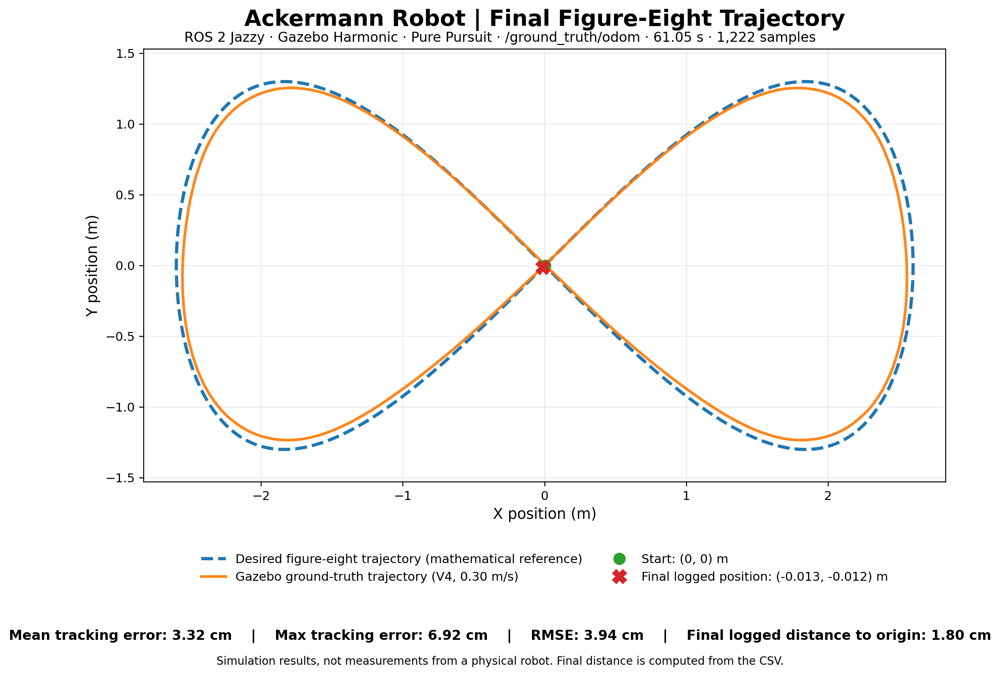
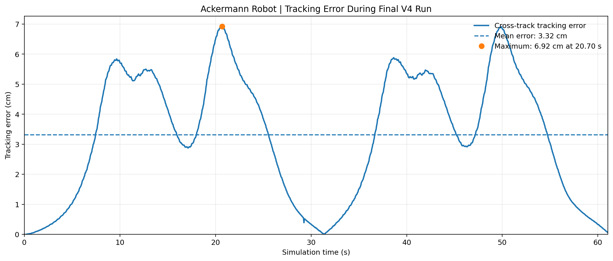
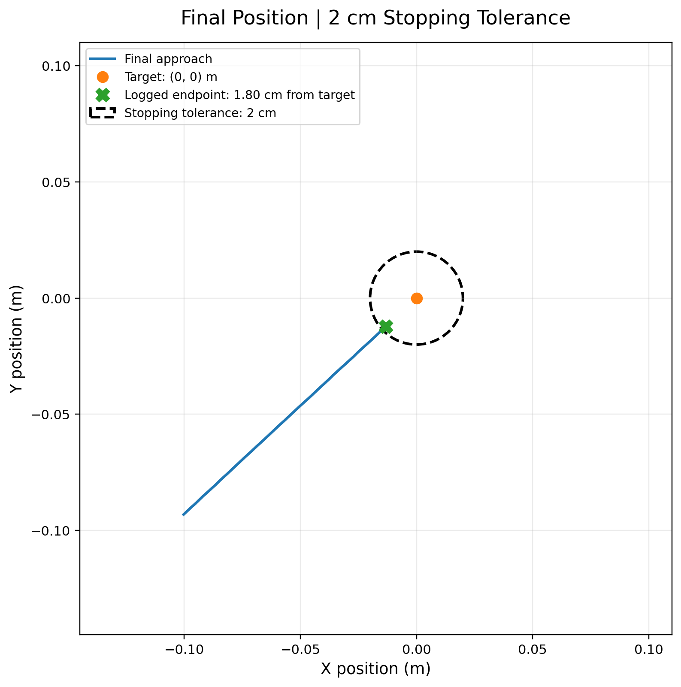
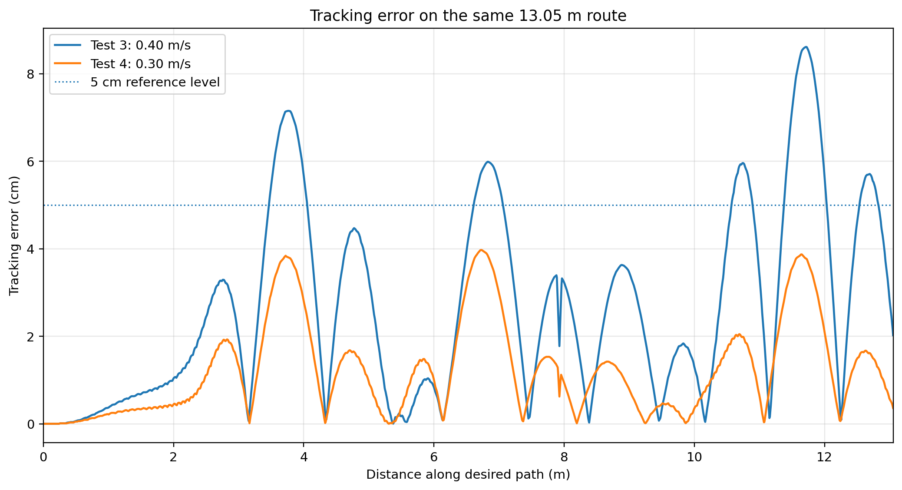

# Ackermann Mobile Robot — ROS 2 Jazzy & Gazebo Harmonic

**Midterm Project | Mobile Robotics | Group G10**  
**Autodesk Fusion 360 · URDF/Xacro · ROS 2 Jazzy · Gazebo Harmonic · Pure Pursuit**

This repository contains the ROS 2 packages for a four-wheel mobile robot with **Ackermann steering geometry**. The robot model was designed in Autodesk Fusion 360, described in URDF/Xacro, spawned in Gazebo Harmonic, and controlled with a Python **Pure Pursuit** node. The controller follows **one figure-eight trajectory**, reduces speed near the final waypoint, and automatically commands a stop within a configurable goal tolerance.



> **Demonstration video:** https://youtu.be/-HHaQ467vGU  

## 1. Platform and dependencies

**Tested configuration reported by the project team:**

| Component | Version / package |
| --- | --- |
| Operating system | Ubuntu 24.04 LTS |
| ROS middleware | ROS 2 Jazzy |
| Simulator | Gazebo Harmonic |
| ROS–Gazebo bridge | `ros_gz_bridge`, `ros_gz_sim` (via `ros-jazzy-ros-gz`) |
| Robot description | URDF / Xacro |
| Controller | Python 3, `rclpy`, `geometry_msgs`, `nav_msgs` |
| Build tools | `colcon`, `rosdep` |
| Other ROS packages | `robot_state_publisher`, `joint_state_publisher`, `joint_state_publisher_gui`, `rviz2`, `xacro` |

**Important:** These instructions target **Jazzy + Harmonic**. ROS 2 Humble is not claimed to have been tested with this repository.

After installing ROS 2 Jazzy and the Gazebo Harmonic integration following the official instructions, install the project-level packages:

```bash
sudo apt update
sudo apt install -y \
  ros-jazzy-ros-gz \
  ros-jazzy-xacro \
  ros-jazzy-robot-state-publisher \
  ros-jazzy-joint-state-publisher \
  ros-jazzy-joint-state-publisher-gui \
  ros-jazzy-rviz2 \
  python3-colcon-common-extensions \
  python3-rosdep
```

References: [ROS 2 Jazzy installation](https://docs.ros.org/en/jazzy/Installation/Ubuntu-Install-Debs.html), [Gazebo + ROS installation](https://gazebosim.org/docs/harmonic/ros_installation/).

## 2. Repository structure

```text
Ackermann_G10_ROS2/
├── src/
│   ├── ackerman_description/
│   │   ├── launch/gazebo.launch.py      # Starts Gazebo, bridge, robot state publisher, spawn
│   │   ├── urdf/ackerman.xacro          # Main robot model
│   │   ├── urdf/ackerman.gazebo         # Gazebo Ackermann and odometry plugins
│   │   ├── config/ros_gz_bridge_gazebo.yaml
│   │   ├── meshes/                      # Robot STL meshes
│   │   └── package.xml
│   └── ackermann_trajectory_controller/
│       ├── ackermann_trajectory_controller/trajectory_node.py
│       ├── setup.py
│       └── package.xml
├── scripts/                         # Convenience wrappers
├── docs/RESULTS.md                  # Experimental methodology and results
├── assets/                          # Comparison figures
├── results/                         # Selected CSV logs, if provided
├── .gitignore
└── README.md
```

## 3. Clone, install dependencies, and build

Open a terminal (replace `<GITHUB_USERNAME>` with the repository owner's username):

```bash
git clone https://github.com/Dacavela/Ackermann_G10_ROS2.git
cd Ackermann_G10_ROS2
source /opt/ros/jazzy/setup.bash
rosdep update
rosdep install --from-paths src --ignore-src -r -y
colcon build --symlink-install
source install/setup.bash
```

`rosdep init` is required only once per machine if it has never been initialized. If the workspace has been edited since the last build, run `colcon build --symlink-install` again.

Check that both packages were installed:

```bash
ros2 pkg prefix ackerman_description
ros2 pkg prefix ackermann_trajectory_controller
```

## 4. Run the simulation — exact terminal commands

Use **separate terminals**. For every new terminal, source ROS 2 and the built workspace.

### Terminal 1 — Start Gazebo and spawn the robot

```bash
cd ~/Ackermann_G10_ROS2
source /opt/ros/jazzy/setup.bash
source install/setup.bash
ros2 launch ackerman_description gazebo.launch.py
```

The launch starts the `empty` world and spawns a model called `ackerman` at approximately `(0, 0)` with an initial yaw of 45°. Wait until the robot has appeared and settled before starting the controller.

### Terminal 2 — Confirm the world-frame pose topic

```bash
cd ~/Ackermann_G10_ROS2
source /opt/ros/jazzy/setup.bash
source install/setup.bash
ros2 topic list | grep ground_truth
ros2 topic echo /ground_truth/odom --once --field pose.pose.position
gz model -m ackerman --pose
```

`/ground_truth/odom` must exist. Its position should match the Gazebo world pose for the stationary robot (within numerical precision). **Do not run the controller if this topic is absent.**

### Terminal 3 — Run the final figure-eight trajectory

```bash
cd ~/Ackermann_G10_ROS2
source /opt/ros/jazzy/setup.bash
source install/setup.bash
ros2 run ackermann_trajectory_controller trajectory_node \
  --ros-args \
  -p use_sim_time:=true \
  -p odom_topic:=/ground_truth/odom \
  -p radius:=2.6 \
  -p lookahead:=0.45 \
  -p speed:=0.30 \
  -p path_rotation_deg:=0.0 \
  -p goal_tolerance:=0.02 \
  -p slowdown_distance:=0.60 \
  -p csv_path:="$HOME/resultado_ackermann_final.csv"
```

The controller follows a **single** figure eight, slows down near the end, sends a zero-velocity command when the last waypoint is reached within the tolerance, and saves a CSV log. After it reports completion, you may stop the node with `Ctrl+C`.

### Terminal 4 — Monitor or record telemetry (optional)

```bash
cd ~/Ackermann_G10_ROS2
source /opt/ros/jazzy/setup.bash
source install/setup.bash
ros2 topic echo /ground_truth/odom --field pose.pose.position
```

For recording ROS data instead of printing it:

```bash
mkdir -p ~/ackermann_rosbags
ros2 bag record -o ~/ackermann_rosbags/figure_eight \
  /ground_truth/odom /odom /cmd_vel /clock
```

This records a **ROS bag, not a screen video**. Record the Gazebo window separately for the video deliverable. Stop the bag recorder with `Ctrl+C`.

## 5. Verify the final position

After the robot has stopped, leave Gazebo running and query its pose:

```bash
gz model -m ackerman --pose
```

For world coordinates `(x, y)`, the final distance to the origin is:

\[
e_{f}=\sqrt{x^{2}+y^{2}}.
\]

A project-team run with `goal_tolerance = 0.02 m` reported **(−0.011151, −0.010369) m**, corresponding to **0.0152 m (1.52 cm)** from the Gazebo world origin. This is a **simulation ground-truth measurement**; it is **not** physical-robot localization accuracy and should not be attributed to `/odom` wheel odometry.

## 6. Robot kinematics and controller

The equivalent bicycle model is

\[
\dot{x}=v\cos\psi,\quad
\dot{y}=v\sin\psi,\quad
\dot{\psi}=\frac{v}{L}\tan\delta.
\]

The figure-eight reference is a Gerono-type curve:

\[
x(\tau)=R\sin\tau,\qquad
y(\tau)=R\sin\tau\cos\tau,\quad 0\leq\tau\leq2\pi.
\]

The controller computes a lookahead target, finds its relative angle `alpha` and distance `d`, and requests the steering angle approximately as

\[
\delta=\tan^{-1}\left(\frac{2L\sin\alpha}{d}\right),
\]

subject to a steering command limit. The Gazebo Ackermann steering system converts the commanded linear and angular velocities into steering and wheel actuation.

| Parameter | Value | Source |
| --- | ---: | --- |
| Wheelbase `L` | 0.24 m | Xacro / Gazebo plugin |
| Kingpin separation | 0.24 m | Gazebo plugin |
| Wheel radius | 0.03 m | Gazebo plugin |
| Steering limit used by controller | ±0.48 rad | `trajectory_node.py` |
| Path radius parameter | 2.6 m | Final run command |
| Lookahead distance | 0.45 m | Final run command |
| Reference speed | 0.30 m/s | Final run command |
| Goal tolerance | 0.02 m | Final run command |

**Pose-frame note:** The simulation publishes both conventional `/odom` and `/ground_truth/odom`. The final demonstration controls against `/ground_truth/odom` in the world frame and uses `path_rotation_deg:=0.0`. If controlling against `/odom` instead, the reference frame must be handled separately; do not compare untransformed poses from different frames.

## 7. Experimental results — final V4 simulation

### 7.1 Final figure-eight trajectory (world-frame ground truth)

The final ROS 2 Jazzy / Gazebo Harmonic run uses **Pure Pursuit** and the
`/ground_truth/odom` topic to track a full figure-eight path. The steering
controller uses Gazebo simulation ground truth rather than an onboard
localization system; the results **do not represent physical-robot accuracy**.


**Final-run configuration:** 0.30 m/s reference speed; 0.45 m lookahead;
2.6 m figure-eight radius parameter; `path_rotation_deg = 0`;
`goal_tolerance = 0.02 m`.

| Metric | Final V4 CSV result |
| --- | ---: |
| Recorded samples | 1,222 |
| Duration | 61.05 s |
| Mean tracking error | **3.32 cm** |
| Maximum tracking error | **6.92 cm** |
| RMSE | **3.94 cm** |
| Final logged distance to origin | **1.80 cm** |



The final CSV sample is located at approximately **(-0.0132, -0.0122) m**,
which is **1.80 cm** from the desired origin, inside the 2 cm stopping
tolerance. A **separate, later** `gz model -m ackerman --pose` query reported
**(-0.011151, -0.010369) m**, or approximately **1.52 cm** from the world
origin; the measurements were taken at different instants and should not be
presented as identical.



The reproducible input log is
[`results/resultado_world_precision_2cm.csv`](results/resultado_world_precision_2cm.csv).
Regenerate all three visualizations locally with:

```bash
sudo apt install -y python3-numpy python3-pandas python3-matplotlib
python3 scripts/plot_ackermann_v4.py \
  results/resultado_world_precision_2cm.csv --output assets
```

### 7.2 Earlier controller optimization (tests 3 and 4)

In earlier experiments, two settings were compared over a **matched 13.05 m
path segment**. Reducing the reference speed from 0.40 to 0.30 m/s reduced
the distance-normalized mean tracking error from about **2.63 cm to 1.22 cm**;
the maximum error decreased from **8.61 cm to 3.97 cm** over that segment.
These tests precede V4 and should **not** be confused with the complete
world-frame final run documented above.



See [`docs/RESULTS.md`](docs/RESULTS.md) for the original comparative methodology.

## 8. Troubleshooting

| Symptom | Check |
| --- | --- |
| `Package 'ackerman_description' not found` | Source `/opt/ros/jazzy/setup.bash`, build from repository root, and source `install/setup.bash`. |
| `/ground_truth/odom` is missing | Verify `ackerman.gazebo`, the bridge YAML, `ros_gz_bridge` installation, and that the robot was spawned. |
| Robot deviates from the world origin | Confirm use of `/ground_truth/odom` with `path_rotation_deg:=0.0`; compare `gz model -m ackerman --pose`. |
| Robot does not stop at the first origin crossing | The end condition is only evaluated after advancing to the last path waypoint. |
| Gazebo launch fails | Check that `ros-jazzy-ros-gz` and Gazebo Harmonic are installed and that no stale Gazebo instance is running. |
| `colcon` or `rosdep` command not found | Install the build/dependency tools listed in Section 1. |

