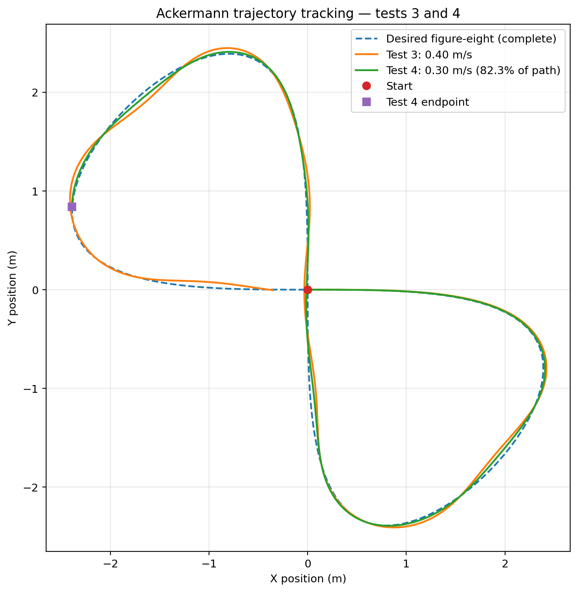
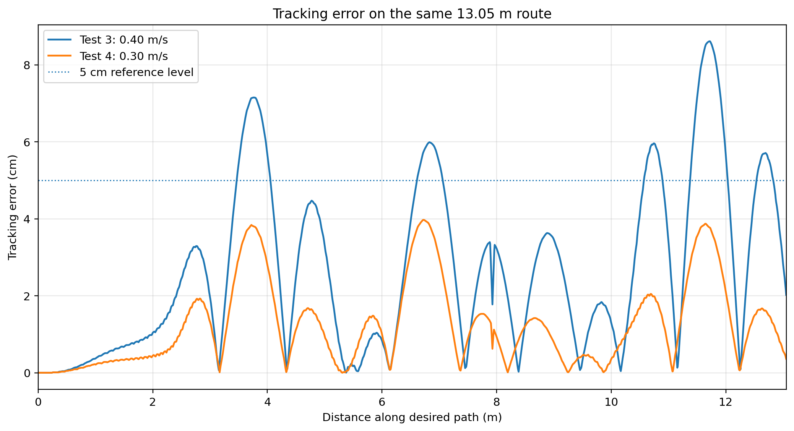
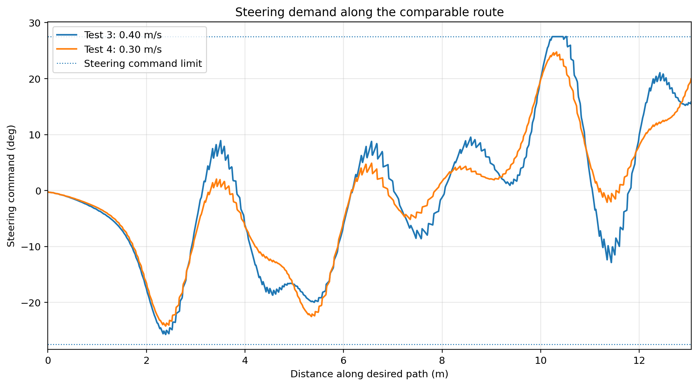

# Experimental Results and Interpretation

**Scope.** These are simulation results reported by the project team. Raw CSV exports for earlier tuning runs may be included in `results/`, while the final ground-truth position was verified using the Gazebo model pose command.

## 1. Pure Pursuit speed comparison

Both runs used `radius=2.6 m`, `lookahead=0.45 m` and a reference rotation of −45° in the conventional `/odom` frame. Errors were evaluated over the same **13.05 m arc-length segment**, rather than the same elapsed time, because the robot moved at different speeds.

| Metric (matched segment) | Run 3: 0.40 m/s | Run 4: 0.30 m/s |
| --- | ---: | ---: |
| Mean lateral tracking error | 0.0263 m | 0.0122 m |
| Maximum tracking error | 0.0861 m | 0.0397 m |
| RMSE | 0.0341 m | 0.0163 m |

Mean tracking error decreased by approximately **53.5%** on the matched segment. The comparison suggests lower commanded velocity improved tracking in this simulation, but it does not isolate the detailed physical cause (steering lag, wheel-ground dynamics, controller discretization, etc.).

## 2. Ground-truth closed-loop endpoint

The final controller uses the simulated world pose as feedback (`/ground_truth/odom`) and `path_rotation_deg=0.0`. With `radius=2.6 m`, `lookahead=0.45 m`, `speed=0.30 m/s`, and `goal_tolerance=0.02 m`, the reported Gazebo model pose at the end was:

```text
x = -0.011151 m
y = -0.010369 m
yaw = 0.749665 rad
```

This gives a Euclidean world-frame distance to `(0,0)` of approximately **0.01523 m (1.52 cm)**. The value satisfies the 2 cm target **for that run**. It does not guarantee identical behavior on every run.

## 3. Essential caveats

1. The **earlier speed comparison** and the **final ground-truth endpoint** are separate experiments. Do not substitute one set of data for the other.
2. `/ground_truth/odom` is derived from simulator state. It is not a practical localization source on a physical robot; compare it with `/odom` to study odometry drift and frame alignment.
3. Spatially normalized errors are obtained by aligning data across the same path distance; direct averages over unequal-time logs are not a controlled comparison.
4. An endpoint tolerance measures **arrival at the goal**, while the path tracking error measures **distance to the reference curve**. These should not be treated as the same metric.
5. Before a final paper, save the full-run CSV and the actual video URL, then regenerate any plots from that specific run if required.






